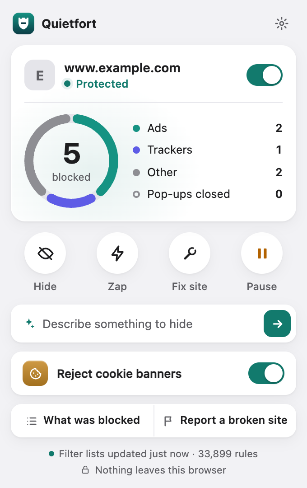
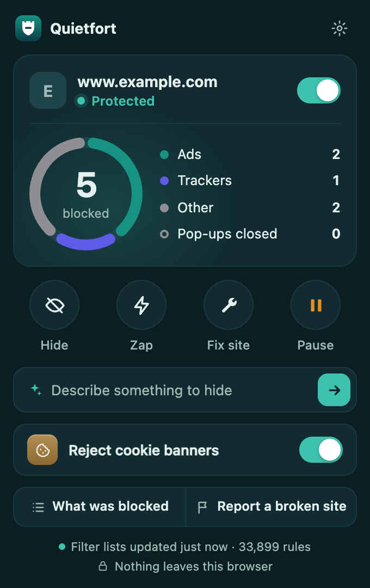
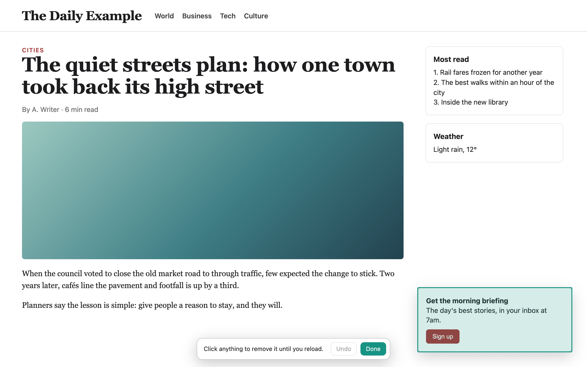

<div align="center">


# Quietfort

**The web, without the noise.**

A calm, private ad blocker for Chrome, Firefox and Safari.<br>
Blocks ads, trackers, cookie pop-ups and dangerous sites, and nothing you browse ever leaves your device.

[**Website**](https://enigmaticzee.github.io/Quietfort-extension/) ·
[**Download**](https://github.com/EnigmaticZee/Quietfort-extension/releases/latest) ·
[**Privacy**](docs/PRIVACY.md) ·
[**Report a problem**](https://github.com/EnigmaticZee/Quietfort-extension/issues)


<br>

&nbsp;&nbsp;


</div>

---

## Why Quietfort

- **Ads, gone.** Banners, pop-ups, pop-unders and video ads, including the ones that sneak back in after the page loads.
- **Trackers stopped.** Analytics beacons, fingerprinting scripts and tracking pixels never load. Global Privacy Control is on by default.
- **Cookie banners, rejected.** Consent pop-ups are answered for you, always "reject" or "necessary only", never "accept".
- **Dangerous sites, flagged.** Known phishing, scam and malware sites show a clear warning page first.
- **Zap and hide.** Click anything to remove it for this visit, hide it on a site for good, or just describe it: *"the newsletter pop-up"*.
- **Site broken? One button.** Quietfort finds the exact rule that broke a page and switches off only that one.
- **Calm by design.** One small panel, short labels, three themes (Light, Fort Night, Graphite), pause everywhere, trusted sites, your own rules, a log of what was blocked, and backup and restore.

<p align="center"></p>

## Install

Store listings are on the way. Until then, install the latest release directly:

| Browser | How |
|---|---|
| **Chrome, Edge, Brave, Opera, Vivaldi** | Download [`quietfort-chrome.zip`](https://github.com/EnigmaticZee/Quietfort-extension/releases/latest/download/quietfort-chrome.zip) and unzip it. Open `chrome://extensions` (or `edge://extensions`, `brave://extensions`…), turn on **Developer mode**, click **Load unpacked** and choose the folder. For full protection (the filter lists' fixes for YouTube and sites that block ad blockers), press **Turn on full protection** in Quietfort and switch on **Allow User Scripts**: Chrome only runs downloaded page fixes after you allow it. |
| **Firefox** | Download [`quietfort-firefox.zip`](https://github.com/EnigmaticZee/Quietfort-extension/releases/latest/download/quietfort-firefox.zip). Open `about:debugging#/runtime/this-firefox` and click **Load Temporary Add-on**. Firefox removes it on restart until the Add-ons listing is live. |
| **Safari** | Coming to the Mac App Store. Developers can [build it from source](#safari). |

## Privacy

Quietfort runs entirely in your browser. There are no accounts, no analytics, no ads and no crash reporting, and nothing you browse is sent anywhere. The only downloads it makes on its own are filter lists, straight from their maintainers. The optional AI features use the browser's own on-device model, where one exists. Read the full [privacy policy](docs/PRIVACY.md).

## Build from source

You need [Node.js](https://nodejs.org/) 24 or later.

```sh
git clone https://github.com/EnigmaticZee/Quietfort-extension.git
cd Quietfort-extension/extensions
npm ci
npm test                                   # typecheck, build and unit tests
node scripts/build.mjs chrome firefox      # builds into dist/chrome and dist/firefox
```

Load `extensions/dist/chrome` with **Load unpacked**, or `extensions/dist/firefox/manifest.json` with **Load Temporary Add-on**.

### Safari

Safari runs extensions only inside a signed Mac app. The companion app in [`extensions/safari-app/`](extensions/safari-app/) also carries the extra content-blocker rule sets that let Safari block as much as the other browsers. You need Xcode and an Apple developer team:

```sh
cd extensions
node scripts/build.mjs safari
cd "safari-app/AdBlocker Companion"
xcodebuild -project "AdBlocker Companion.xcodeproj" -scheme "AdBlocker Companion" \
  -configuration Debug -derivedDataPath ../build DEVELOPMENT_TEAM=<your team id> \
  CODE_SIGN_STYLE=Automatic -allowProvisioningUpdates build
open "../build/Build/Products/Debug/AdBlocker Companion.app"
```

Then turn on Quietfort and its three Rules extensions in **Safari → Settings → Extensions**.

### Tests

| Command (in `extensions/`) | What it runs |
|---|---|
| `npm test` | Typecheck, build and unit tests |
| `npm run test:e2e:chrome` | End-to-end checks in real Chrome |
| `npm run test:e2e:firefox` | End-to-end checks in real Firefox |
| `npm run test:e2e:extras` | Pause, My Rules, trusted sites, log, backup, describe, right-click, zap |
| `npm run test:runtime` | The in-page scripts |
| `npm run test:e2e:safari` | End-to-end checks in real Safari (needs the companion app) |

## How it's organised

```
extensions/
  src/background/   service worker: lists, blocking rules, Safari content blockers, tools
  src/content/      in-page scripts: element hiding, picker, zap, cookie banners
  src/shared/       filter engine: parser, matcher, rule compiler, list catalogue
  src/popup/ src/options/ src/welcome/ src/log/ src/blocked/   the extension's pages
  page-runtime/     page scripts (scriptlets) and the cookie-banner host
  safari-app/       the Safari companion app
  test/             unit and end-to-end tests
site/               the website (GitHub Pages)
docs/PRIVACY.md     the privacy policy
```

## Contributing

Bug reports and ideas are very welcome: please [open an issue](https://github.com/EnigmaticZee/Quietfort-extension/issues). For anything security-related, follow [SECURITY.md](SECURITY.md) instead.

## Credits and licence

Quietfort is released under the [Mozilla Public License 2.0](LICENSE).

Filter lists come from their volunteer maintainers (EasyList, EasyPrivacy, the uBlock Origin and AdGuard filter lists, The Block List Project and others). They're downloaded by your browser at runtime, never bundled or modified, and credited in the extension. Cookie-banner rules come from DuckDuckGo's [autoconsent](https://github.com/duckduckgo/autoconsent) (MPL-2.0). See [THIRD_PARTY_NOTICES.md](THIRD_PARTY_NOTICES.md).
